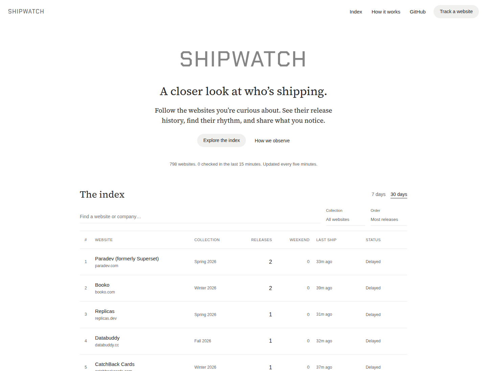

<p align="center">
  
</p>

<h1 align="center">Shipwatch</h1>

<p align="center"><strong>Who shipped while you slept?</strong><br>A public pulse on frontend releases across the web.</p>

<p align="center">
  <a href="https://shipwatch.54.219.237.10.sslip.io">Live site</a> ·
  <a href="#quick-start">Quick start</a> ·
  <a href="#what-counts-as-a-release">Methodology</a> ·
  <a href="https://github.com/dennisimoo/shipwatch/issues">Feedback</a>
</p>

<p align="center">
  <a href="https://github.com/dennisimoo/shipwatch/actions/workflows/check.yml"></a>
</p>



## The idea

Watch public JavaScript bundles every five minutes and see which websites change, how often, and when.

- **Who's shipping:** 7- and 30-day leaderboards, website search, and cohort filters.
- **When they ship:** weekend release counts and an hourly activity heatmap in UTC.
- **Show the evidence:** each company has its baseline date, check history, and release fingerprints.
- **Bring a website:** discover linked domains, review Luna's suggestions, and check the URLs you want to monitor.

**Any public website can join.** The prefilled starter dataset is **797 active/public companies from YC's Winter, Spring, Summer, and Fall 2026 batches**. Older companies aren't kept in a separate directory. New sites start with a baseline; history fills in as the observer runs.

> A bundle change is a frontend release signal, not a commit count, backend deployment count, or measure of how hard a team works.

## Quick start

Install [Bun](https://bun.sh) **1.4.4 or newer**, then:

```sh
git clone https://github.com/dennisimoo/shipwatch.git
cd shipwatch
bun install
bun run import:yc
bun run dev
```

Open **http://localhost:3000**. SQLite is created in `data/shipwatch.sqlite`. No database server or cloud credentials needed.

```sh
bun test
bun run typecheck
```

AI URL discovery needs a server-side `OPENAI_API_KEY` with access to `gpt-6-luna` through the [OpenAI Decisions API](https://developers.openai.com/api/docs/guides/decisions). Existing monitoring and read APIs work without that key. Credentials never go to the browser.

## Pick what gets watched

Enter a company website, then check or uncheck the discovered URLs. At least one URL is required. **Visitors cannot change discovery or monitoring limits.** Both are owned by the server in `config.json`: review up to **12 candidate domains** and monitor at most **3 domains** per company by default. Operators edit that file and restart the app; there are no environment variables or public settings endpoints for these limits.

Discovery follows actual public links on related domains, using the public-suffix list to keep unrelated sites separate. It inspects at most one URL per discovered hostname, within the server's review budget, and asks Luna one yes/no question for each: **should this URL be monitored as the company's product app?** Suggestions with a yes probability of at least 70% are prechecked up to the server's monitoring cap. You can check or uncheck any inspectable URL before confirming, including overriding a suggestion.

Each selected URL gets its own baseline and polling state. Company release counts deduplicate identical fingerprints across its URLs. Profiles show the actual monitored URLs; release evidence retains the originating URL. Discovery is not a subdomain scan and cannot find unlinked or private apps.

The existing YC cohort is reviewed gradually in the background. If Luna recommends no URLs or discovery fails, the existing homepage stays monitored and the profile says so. Successful reviews are saved; Luna is not called during five-minute bundle checks. There are no page categories or second classifier.

## What counts as a release?

```text
Public page → script URLs + content fingerprints → confirm change → SQLite → leaderboard
```

1. **Establish a baseline.** The first successful observation never counts as a release.
2. **Watch first-party JavaScript.** Compare script/module-preload URLs, content hashes for up to eight stable-name scripts, and exposed build IDs. Use conditional requests to avoid downloading unchanged files; track content-hashed filenames by URL.
3. **Confirm it.** A new fingerprint must persist on a follow-up check, targeted for one minute later.
4. **Count it once.** Previously confirmed versions, including the initial baseline, don't count again after a rollback.

Event times mean **first detected**, with the previous successful check and confirmation time preserved. Rankings cover observed events in the selected window. Company profiles show how long we've actually been watching.

**Limits:** backend-only deploys, commits, lazy-loaded routes, and scripts on unrelated CDN domains can be missed. CDN caching delays observations; multiple releases between checks can be missed; A/B tests and regional variants can introduce noise. A marketing homepage may deploy separately from the product. Weekend and hourly stats use **UTC**.

## Small on purpose

**One EC2 instance. One Bun process. One SQLite database.**

The interface is plain HTML, CSS, and a small browser script. Its quiet, serif-led layout uses self-hosted [Source Serif 4](https://github.com/adobe-fonts/source-serif), distributed under the included SIL Open Font License. No frontend framework or build step.

| Piece                             | Choice                                            |
| --------------------------------- | ------------------------------------------------- |
| Runtime / server / tests          | Bun                                               |
| Database                          | Built-in `bun:sqlite`, with WAL                   |
| Website                           | HTML, CSS, browser JavaScript — no frontend build |
| IP classification                 | `ipaddr.js`                                       |
| Robots rules                      | `robots-parser`                                   |
| API rate limits                   | `rate-limiter-flexible`, in memory                |
| HTML attribute decoding           | `entities`                                        |
| URL discovery / domain boundaries | `cheerio`, `tldts`                                |
| Yes/no monitoring decisions       | Official `openai` SDK, Luna Decisions             |
| Bounded discovery concurrency     | `p-limit`                                         |
| HTTPS                             | Caddy                                             |

The observer spreads checks across five-minute windows, limits concurrent work, respects robots disallows, and backs off failures. Private and reserved destinations are blocked, DNS is pinned to the validated address, and fetches have byte/time limits. Slow or unobservable sites show their actual monitoring status.

Submission limits: **one per IP per minute**, **100 new sites per day**. Read APIs: **120 requests per IP per minute**. In-memory limits reset on restart; there's no Redis or distributed rate-limit service.

<details>
<summary><strong>Project map</strong></summary>

```text
src/
  db.ts          Schema and release state transitions
  network.ts     Public HTTP fetching, DNS checks, robots rules
  detect.ts      Script discovery and fingerprints
  poller.ts      Scheduling, confirmations, failure backoff
  import-yc.ts   Import only eligible recent YC companies
  discovery.ts   Linked domains, Luna decisions, bounded selection
  server.ts      Website and API
public/          Responsive website
tests/           Detection, safety boundary, and lifecycle checks
deploy/          EC2 service, HTTPS setup, daily SQLite backup
```

</details>

<details>
<summary><strong>Configuration and API</strong></summary>

| Variable           | Default                 | Purpose                                                |
| ------------------ | ----------------------- | ------------------------------------------------------ |
| `DATABASE_PATH`    | `data/shipwatch.sqlite` | Database file                                          |
| `HOST` / `PORT`    | `127.0.0.1` / `3000`    | HTTP listener                                          |
| `POLL_CONCURRENCY` | `24`                    | Maximum concurrent site checks                         |
| `POLL_ENABLED`     | enabled                 | Set to `0` to serve without polling                    |
| `MONITOR_YEAR`     | `2026`                  | YC batch year selected during import                   |
| `TRUST_PROXY`      | disabled                | Set to `1` only behind the trusted local reverse proxy |

| Endpoint                     | Returns                                                                                          |
| ---------------------------- | ------------------------------------------------------------------------------------------------ |
| `GET /api/summary`           | Counts, coverage, activity, batches, UTC heatmap                                                 |
| `GET /api/companies`         | Leaderboard; accepts `days`, `sort`, `batch`, `search`, `page`                                   |
| `GET /api/company/:id`       | Profile, up to 100 release events, daily check totals                                            |
| `GET /api/discovery-options` | Discovery availability; limits cannot be changed here                                            |
| `POST /api/discover`         | Review `{ "url": "https://example.com", "name": "Example" }`; returns a 30-minute review token   |
| `POST /api/companies`        | Confirm `{ "token": "review-token", "selected": ["https://app.example.com/"] }` from that review |
| `GET /health`                | Database readiness and actual Bun/SQLite versions                                                |

Sort values: `releases`, `weekend`, `recent`. Pages contain up to 50 companies.

</details>

<details>
<summary><strong>Self-hosting and backups</strong></summary>

The live app runs on a regular ARM64 `t4g.small` in **Northern California (`us-west-1`)**, with encrypted gp3 storage and Caddy HTTPS. Compute, disk, and public IPv4 cost roughly **$20/month**, before transfer and small S3 backup charges. CPU credits use standard mode.

Copy the source to `/opt/shipwatch` on an Ubuntu ARM64 instance, then run as root:

```sh
SITE_HOST=your-domain.example BACKUP_BUCKET=your-private-bucket bash deploy/setup.sh
```

Setup installs stable **Bun 1.4.4** and standalone **SQLite 3.54.1** tools. Bun's Linux driver statically links its own SQLite engine; `/health` reports that runtime version. Installing a newer SQLite CLI doesn't change Bun's embedded engine.

The app runs as an unprivileged systemd service. The only backup machinery is a daily, integrity-checked SQLite snapshot uploaded to private S3 storage. Give the instance role `s3:PutObject` on the bucket's `daily/*` prefix and configure 14-day expiration.

```sh
sudo systemctl status shipwatch
sudo journalctl -u shipwatch -n 50
sudo systemctl start shipwatch-backup
```

To restore: stop the app, download/decompress a backup using an operator identity, check `PRAGMA integrity_check`, replace the database, remove stale WAL/SHM files, restore `shipwatch` ownership, and restart. The instance's upload-only role cannot read backups.

This is a side project, not a high-availability service. Measure coverage and resource usage before adding infrastructure.

</details>

## Data and feedback

Company data comes from the unofficial [yc-oss API](https://github.com/yc-oss/api). Only publicly launched companies with valid websites, an eligible batch, and status `Active` or `Public` are imported. Re-running `bun run import:yc` refreshes that selection and removes out-of-scope YC records and their observations; community submissions are preserved.

Found a noisy signal or an unobservable site? [Open an issue](https://github.com/dennisimoo/shipwatch/issues) with the URL and what you observed.
